# BÁO CÁO THỰC HÀNH BÀI 3
## Lưu trữ phân tán: NoSQL và lưu trữ đối tượng

**Học phần:** LING270 - Thực hành Điện toán đám mây  
**Sinh viên:** Nguyễn Duy Phúc  
**MSSV:** 2324802010323  
**Repository:** https://github.com/bishadow27/notes-api-2324802010323

## 1. Mô hình triển khai

Ứng dụng sử dụng Express 5 làm API. MongoDB Atlas lưu dữ liệu ghi chú theo mô hình NoSQL. Tệp đính kèm được tải lên bucket **attachments** trên Supabase Storage; MongoDB chỉ lưu đường dẫn công khai **attachmentUrl**.

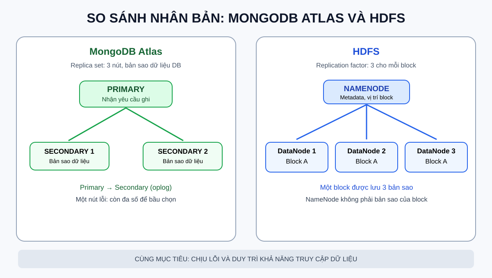

### Cấu hình dịch vụ thực tế

MongoDB Atlas: cloud-lab, Cluster0 Free, AWS Singapore, replica set 3 nút; database notes, user notes_app có quyền readWrite trên notes. Supabase: notes-lab03 Free, Singapore; bucket attachments Public. Bí mật lưu trong .env và không đưa vào repository.

## 2. Minh chứng kiểm thử API

Chạy **npm run smoke** sau khi API kết nối thành công với MongoDB Atlas và Supabase. Điền kết quả thực tế:

| Tình huống | Mã HTTP mong đợi | Kết quả thực tế |
|---|---:|---|
| GET / | 200 | PASS |
| POST /notes | 201 | PASS |
| GET /notes và GET /notes/:id | 200 | PASS |
| PUT /notes/:id | 200 | PASS |
| DELETE /notes/:id | 204 | PASS |
| GET ghi chú đã xóa | 404 | PASS |
| ID không hợp lệ / thiếu title | 400 | PASS |
| POST /notes/:id/attachment | 200 | PASS |
| Mở attachmentUrl | 200 | PASS |

## 3. Kết quả đo hiệu quả chỉ mục

Chạy **npm run seed** để thêm 2.000 ghi chú mẫu, sau đó chạy **npm run explain**. Chụp màn hình kết quả terminal và điền số liệu:

| Phương pháp | docsExamined | nReturned | executionTimeMillis |
|---|---:|---:|---:|
| Quét toàn bộ (COLLSCAN) | 2000 | 571 | 1 |
| Dùng chỉ mục (IXSCAN) | 571 | 571 | 1 |

**Tỉ số giảm số tài liệu phải kiểm tra:**

docsExamined(COLLSCAN) / docsExamined(IXSCAN) = **3,50 lần**.

Ưu tiên đánh giá **docsExamined**. Thời gian thực thi trên 2.000 tài liệu có thể chênh lệch nhỏ và chịu ảnh hưởng của độ trễ mạng, cache và tải cụm.

## 4. Trả lời câu hỏi phản biện

### Câu 1. Với 2.000 tài liệu, chênh lệch thời gian nhỏ. Điều gì xảy ra với 2 triệu tài liệu và giới hạn 100 thao tác/giây?

Nếu phân bố dữ liệu và tỉ lệ xuất hiện tag **docker** giữ nguyên, truy vấn COLLSCAN có thể phải kiểm tra gần 2 triệu tài liệu. Truy vấn dùng chỉ mục chỉ cần kiểm tra các tài liệu phù hợp với tag đó. Có thể ước lượng số tài liệu phải kiểm tra bằng tỉ lệ đo được ở mục 3.

Giới hạn 100 thao tác/giây là giới hạn mức thao tác đọc/ghi của gói miễn phí, không có nghĩa một truy vấn quét 2 triệu tài liệu bị tính thành 2 triệu thao tác API. Dù vậy, truy vấn quét lớn tiêu tốn tài nguyên và có thể làm giảm thông lượng khi nhiều truy vấn chạy đồng thời.

### Câu 2. Vì sao lưu tệp trên Supabase Storage rồi chỉ lưu URL trong MongoDB?

Supabase Storage được thiết kế để lưu và phân phối đối tượng như ảnh, PDF hoặc tệp đính kèm. MongoDB chỉ lưu thông tin ghi chú và URL nên tài liệu gọn hơn, dễ truy vấn và lập chỉ mục. Cách tách này cũng tránh đưa dữ liệu nhị phân lớn vào tài liệu BSON. Với bài thực hành, bucket public giúp kiểm tra URL trực tiếp; không dùng bucket public cho dữ liệu cá nhân hoặc nhạy cảm.

### Câu 3. Atlas nhân bản 3 nút; HDFS mặc định nhân bản 3 block. Mục tiêu chung là gì và đơn vị nhân bản khác nhau ra sao?

Mục tiêu chung là tăng khả năng chịu lỗi và duy trì khả năng truy cập dữ liệu khi một nút hoặc thiết bị lưu trữ gặp sự cố. Atlas nhân bản dữ liệu của replica set giữa Primary và Secondary. HDFS nhân bản từng block của tệp giữa các DataNode. NameNode quản lý metadata, không phải một bản sao dữ liệu block.

## 5. Ảnh minh chứng thực tế

### 1. Atlas project cloud-lab

### 2. Cluster0 Free tại Singapore

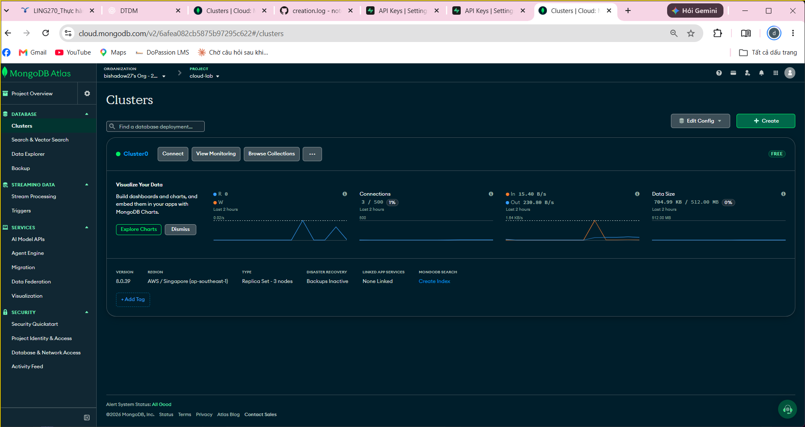

### 3. Database user notes_app

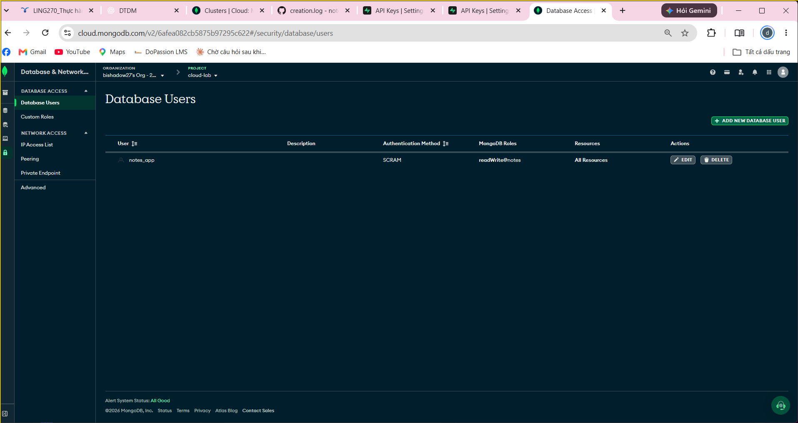

### 4. Network Access

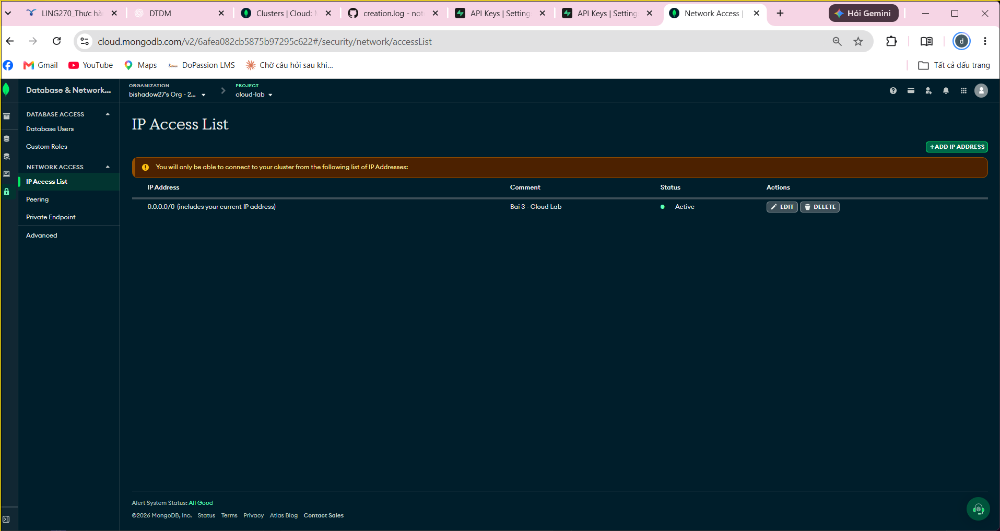

### 5. Bucket attachments Public

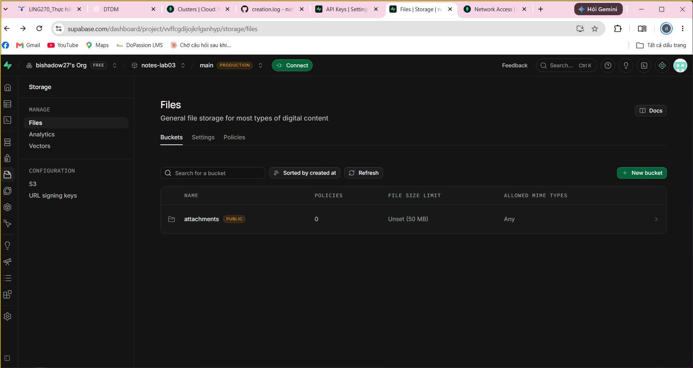

### 6. Kiểm thử CRUD và upload

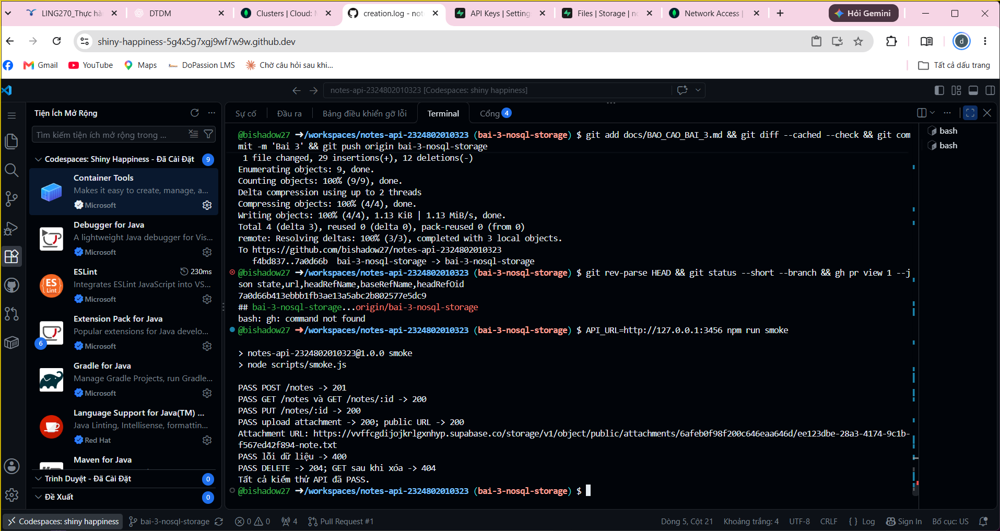

### 7. Tệp đã tải lên

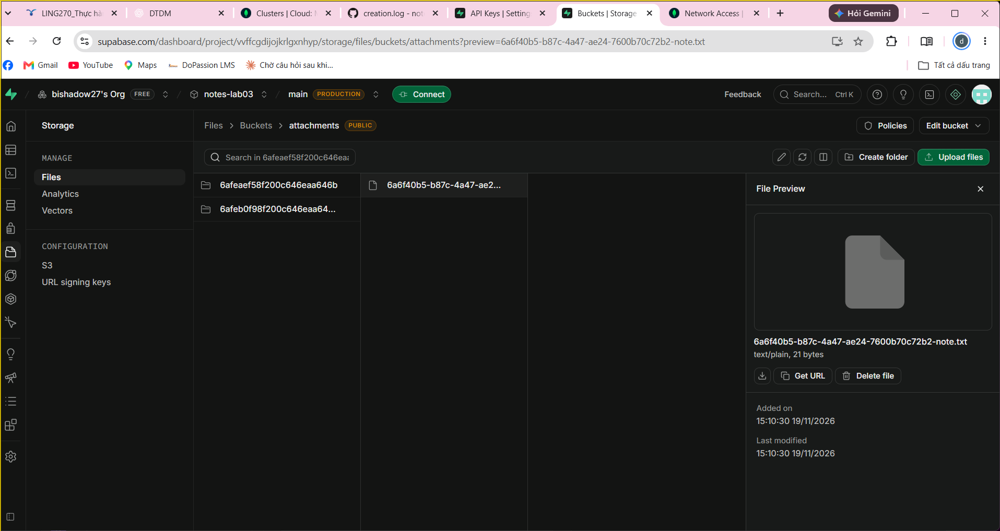

### 8. Mở attachment URL

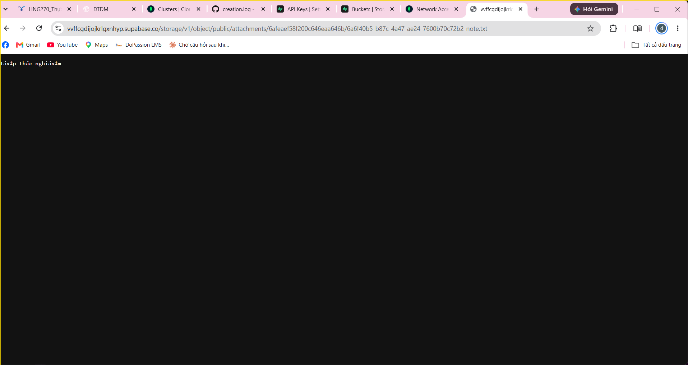

### 9. Kết quả explain

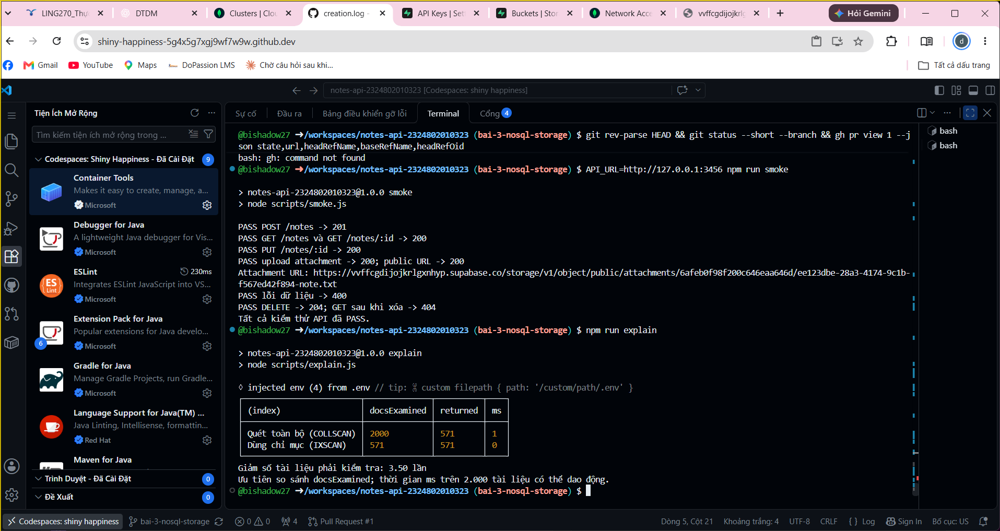

### 10. Replica set 3 nút

### 11. Git status và .env

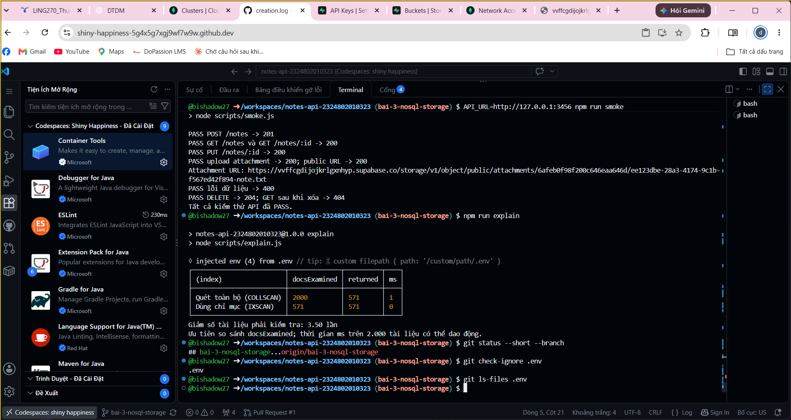

### 12. Commit Bai 3

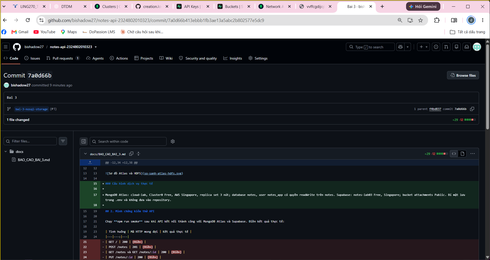

Ảnh 1, 2 và 10 dùng cùng một ảnh gốc. Ảnh 8 cho thấy URL mở được, nhưng tiếng Việt bị hiển thị sai mã hóa. Ảnh 9 là lần đo sau: IXSCAN 0 ms; thời gian thay đổi theo lần chạy.

## 6. Kết quả thực nghiệm trong Codespace

Ngày 19/11/2026, kết nối database `notes` trên Cluster0 thành công. `npm install` và `npm run check` chạy thành công. `npm run seed` xóa 0 ghi chú seed cũ và thêm 2.000 ghi chú mẫu.

| Phương án | docsExamined | nReturned | executionTimeMillis |
| --- | ---: | ---: | ---: |
| COLLSCAN | 2000 | 571 | 1 |
| IXSCAN | 571 | 571 | 1 |

Tỉ số số tài liệu quét là 2000/571 ≈ 3,50 lần; thời gian 1 ms là số đo của lần chạy này.

Kiểm thử CRUD qua HTTP với MongoDB Atlas: GET danh sách 200; POST 201; GET theo ID 200; PUT 200; ID không hợp lệ 400; POST thiếu title 400; DELETE 204; GET sau xóa 404. Ghi chú kiểm thử đã được xóa. Kiểm thử upload lên bucket attachments trả 200; truy cập URL công khai trả 200 (npm run smoke).
